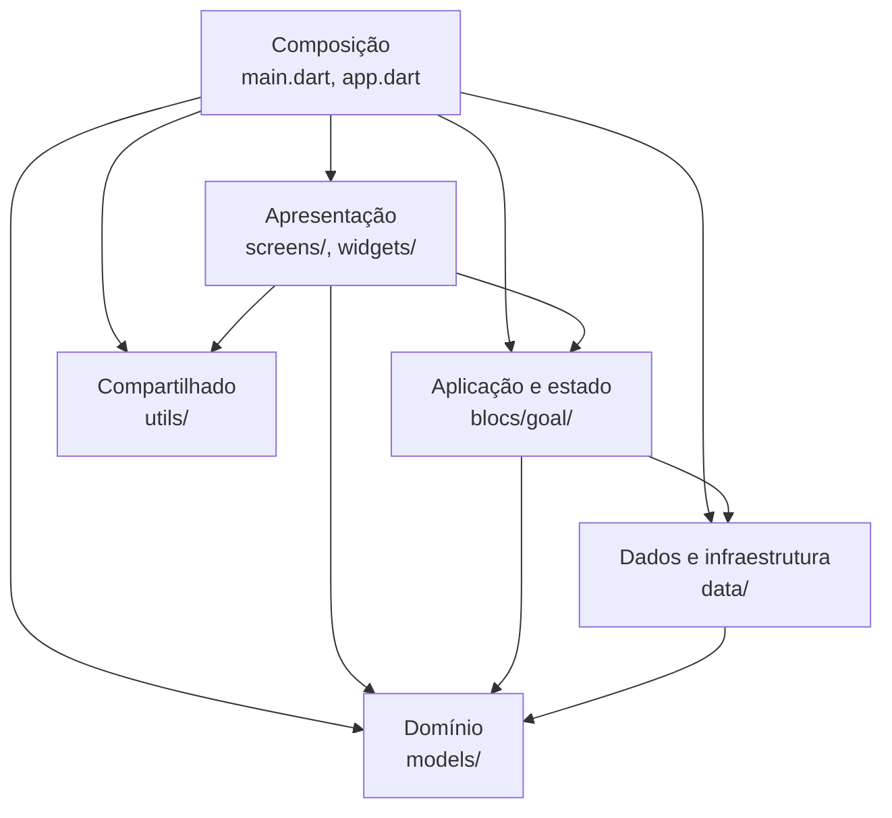

# Camadas da aplicação

A aplicação organiza o código por responsabilidade. As dependências entre
camadas seguem uma direção única para evitar ciclos.

## Camadas, arquivos e responsabilidades

| Camada | Pacotes e classes | Responsabilidade |
| --- | --- | --- |
| Composição | `lib/main.dart` (`main`) e `lib/app.dart` (`MyApp`) | Inicializar o Flutter, conectar as implementações e montar a aplicação. É o ponto de entrada e pode conhecer as outras camadas. |
| Apresentação | `lib/screens/`: `HomeScreen`, `GoalDetailScreen`, `AddEditGoalScreen`; `lib/widgets/`: `GoalTile` | Exibir telas e componentes, encaminhar ações do usuário e renderizar estados. As telas podem navegar entre si dentro da própria camada. |
| Aplicação e estado | `lib/blocs/goal/`: `GoalBloc`, eventos `LoadGoals`, `AddGoal`, `UpdateGoal`, `DeleteGoal` e estados `GoalLoading`, `GoalLoaded`, `GoalError` | Coordenar os casos de uso de metas e transformar eventos em estados. Usa `GoalRepository` e o modelo `Goal`. |
| Dados e infraestrutura | `lib/data/`: `GoalRepository`, `DBHelper`, `ApiService` | Implementar acesso ao SQLite, integração HTTP e operações de repositório. Depende do modelo `Goal` e de bibliotecas externas; não conhece telas ou BLoCs. |
| Domínio | `lib/models/`: `Goal` | Representar os dados e conceitos centrais de uma meta, sem depender de interface, estado ou persistência. |
| Compartilhado | `lib/utils/`: `constants.dart` | Disponibilizar constantes reutilizadas, sem depender das outras camadas da aplicação. |

`GoalRepository` está em `data/` e é consumido pelo `GoalBloc`. Esta é a
fronteira atual entre a coordenação de estado e as implementações de dados.
Os arquivos de tela podem usar componentes da própria apresentação, mas
nenhuma camada de nível inferior deve importar telas, widgets ou o ponto de
composição.

## Dependências permitidas

- Composição pode depender de apresentação, aplicação, dados, domínio e
  compartilhado.
- Apresentação pode depender de aplicação, domínio e compartilhado.
- Aplicação pode depender de dados, domínio e compartilhado.
- Dados podem depender de domínio e compartilhado.
- Domínio e compartilhado não dependem de outras camadas.

Para evitar referências circulares entre camadas, mantenha essas dependências
unidirecionais: camadas inferiores não importam camadas superiores. O
`architecture_linter` verifica as importações entre essas fronteiras no CLI e
no pipeline. Ao criar um novo módulo, classifique-o em uma camada e mantenha
suas dependências dentro da lista permitida.
